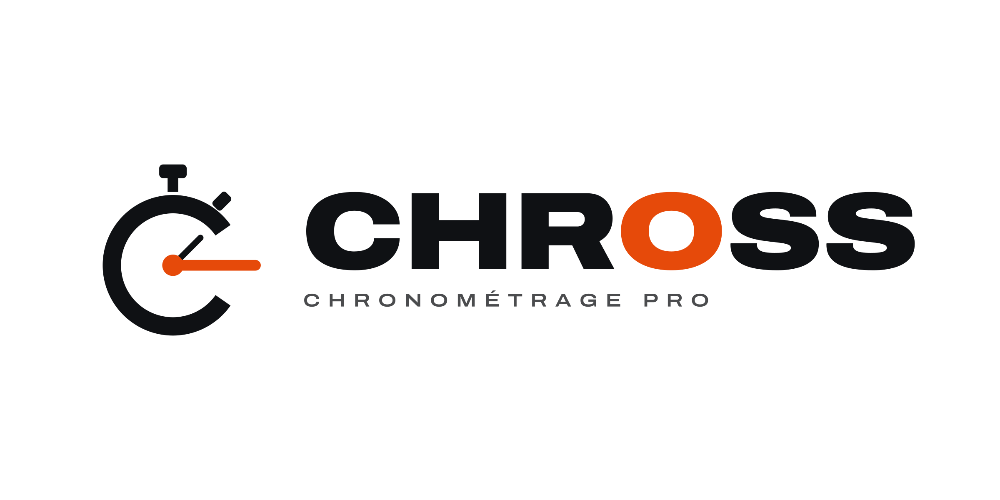
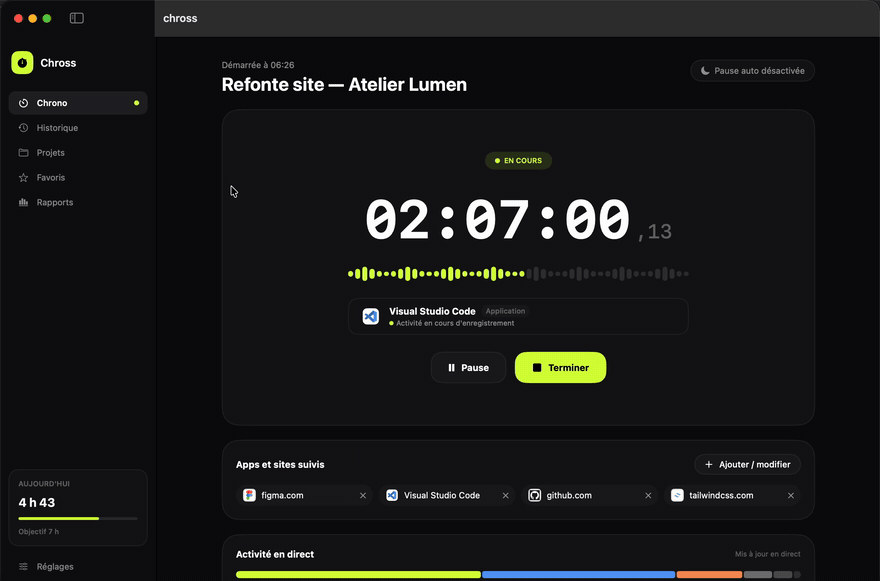
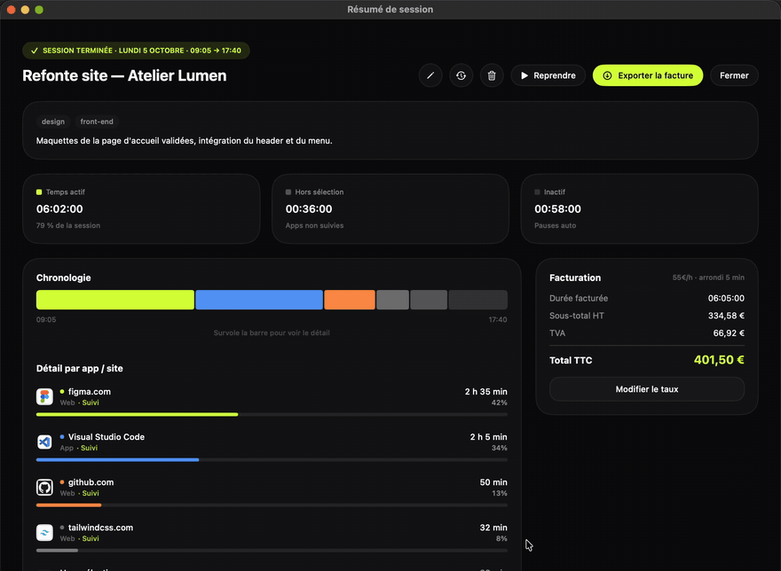
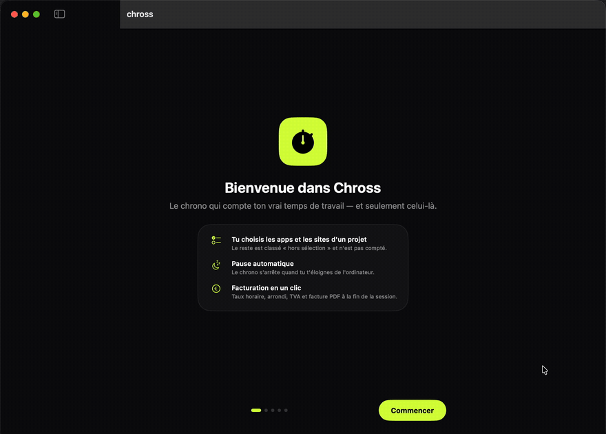
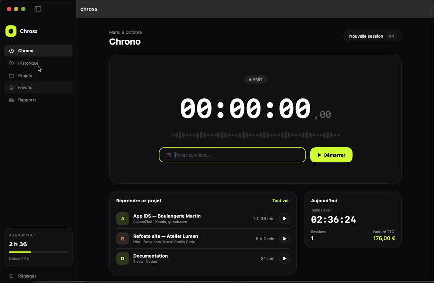

<p align="center">
  <picture>
    <source media="(prefers-color-scheme: dark)" srcset="Chross-logos/logo/png/chross-logo-transparent-blanc.png">
    
  </picture>
</p>

<p align="center">
  <strong>Le chrono macOS qui compte ton vrai temps de travail — et seulement celui-là.</strong>
</p>

<p align="center">
  
  
  
  
</p>

---

Chross est une app de suivi du temps pour freelances et indépendants. Au lieu de compter tout ce qui se passe pendant que le chrono tourne, tu choisis **les apps et les sites qui appartiennent au projet** : seul ce temps-là est compté et facturé. Le reste (réseaux sociaux, messagerie…) est mis de côté en « hors sélection », et les pauses sont détectées automatiquement.

<p align="center">
  
</p>

> Toutes les animations utilisent des données fictives.

## ✨ Fonctionnalités

### ⏱ Suivi précis
- **Périmètre par projet** — tu sélectionnes les apps et les sites web suivis ; tout le reste est classé *hors sélection* et n'est pas compté.
- **Détection des sites** dans Safari, Chrome, Brave, Edge, Arc, Vivaldi, Opera et Firefox.
- **Pause automatique** quand tu t'éloignes du clavier et de la souris (délai réglable).
- **Modification en direct** — ajoute ou retire une app ou un site pendant que le chrono tourne.
- **Activité en direct** avec le temps passé par app / site et leurs favicons.
- Quand tu passes sur un site non suivi (ici youtube.com), Chross le signale et propose de **le suivre en un clic**.

### 📊 Historique et résumés
- **Résumé de fin de session** dans une grande fenêtre : temps actif, hors sélection, inactif, chronologie interactive (survol pour le détail) et répartition par app / site.

<p align="center">
  
</p>

- **Correction des horaires à la souris** — recadre le début et la fin avec des poignées, et découpe les périodes à retirer (pause déjeuner oubliée…) directement sur une barre horaire, avec aperçu avant / après.

<p align="center">
  
</p>

- **Rapports par projet** et **export CSV** de l'historique.

### 💶 Facturation
- Taux horaire, devise, arrondi (aucun, 1, 5 ou 15 min), TVA et base de calcul (temps total ou éléments suivis uniquement).
- **Facture PDF** avec les infos et le logo de ton entreprise, numérotation automatique.

### 🔔 Rappel « Tu travailles sans chrono »
Une notification te prévient quand tu travailles sur un de tes projets sans avoir lancé le chrono — avec un bouton **Démarrer** qui lance directement le bon projet. Les règles sont strictes pour éviter les faux positifs :
- au moins 80 % des dernières minutes passées activement sur un élément suivi, et toujours dessus ;
- jamais pour les apps système (Finder, Réglages Système…) ni pour un navigateur sans site suivi ;
- jamais juste après une session, au maximum une fois toutes les 30 min, avec « Plus tard » et « Ne plus me rappeler pour ça ».

### 🧩 Et aussi
- **Projets** (presets) : une session configurée — apps, sites, taux — lancée en un clic.
- **Favoris** : tes apps et sites habituels, proposés partout en un clic.
- **Widget** macOS avec le temps du jour et l'objectif quotidien.
- **Barre des menus** : le chrono reste visible, fenêtre fermée.
- **Extension Chrome** pour piloter le chrono et ajouter le site courant depuis le navigateur.
- **Menu latéral personnalisable** par glisser-déposer, **introduction** au premier lancement et réglages complets.

<table>
  <tr>
    <td align="center" width="50%"><br><sub>Introduction : les autorisations, une par une</sub></td>
    <td align="center" width="50%"><br><sub>Favoris et réglages organisés par rubriques</sub></td>
  </tr>
</table>

## 🔐 Confidentialité

Tout reste **sur ton Mac** : aucune donnée n'est envoyée nulle part, il n'y a ni compte ni serveur. Pour reconnaître les sites, Chross lit uniquement **l'adresse de l'onglet actif** — jamais le contenu des pages. La seule requête réseau sert à récupérer les icônes (favicons) des sites suivis.

## 🛠 Compiler depuis les sources

**Prérequis :** macOS 15 ou plus récent, Xcode 16 ou plus récent, un compte Apple (gratuit suffit).

```bash
git clone https://github.com/SweezZze/chross-macos.git
cd chross-macos
open chross.xcodeproj
```

Dans Xcode, pour les cibles **chross** et **ChrossWidgetExtension** (onglet *Signing & Capabilities*) :

1. choisis ta propre **Team** ;
2. remplace l'identifiant `com.louismenthonnex.chross` par le tien (le widget doit garder le suffixe `.ChrossWidget`) ;
3. remplace l'App Group `group.com.louismenthonnex.chross` par le tien, dans les deux cibles et dans `SharedStats.swift` (`chross/Utilities` et `ChrossWidget`).

Puis lance avec **⌘R**, ou compile une version finale :

```bash
xcodebuild -project chross.xcodeproj -scheme chross -configuration Release \
  -derivedDataPath build -allowProvisioningUpdates build
cp -R build/Build/Products/Release/chross.app /Applications/
```

> Signer avec ton certificat de développeur (et non en « ad hoc ») permet à macOS de conserver les autorisations d'une compilation à l'autre.

## 🔑 Autorisations demandées

| Autorisation | Pourquoi | Obligatoire |
| --- | --- | --- |
| **Accessibilité** | Lire l'adresse de l'onglet actif pour reconnaître les sites | Non — sans elle, seules les apps sont suivies |
| **Notifications** | Rappel « Tu travailles sans chrono » | Non |
| **Automatisation** (par navigateur) | Solution de secours pour lire l'adresse quand l'Accessibilité ne suffit pas | Non |

L'introduction du premier lancement les demande une par une, et **Réglages → Autorisations** affiche leur état en direct.

## 🧭 Extension Chrome

1. Ouvre `chrome://extensions` et active le **Mode développeur**.
2. Clique sur **Charger l'extension non empaquetée** et choisis le dossier [`ChrossChromeExtension`](ChrossChromeExtension).

L'extension communique avec l'app via un petit serveur local (`127.0.0.1:52847`), uniquement sur ton Mac. Détails dans son [README](ChrossChromeExtension/README.md).

## 🗂 Structure du projet

```
chross/
├── Models/        Sessions, projets, favoris (SwiftData)
├── Tracking/      Suivi d'activité, détection des sites, rappels
├── Billing/       Calcul de facturation, correction des horaires
├── Networking/    Serveur local pour l'extension Chrome
├── Utilities/     Thème, formatage, favicons, autorisations
├── Views/         Interface SwiftUI
└── Demo/          Mode démo des versions Debug (données fictives pour les animations)
ChrossWidget/            Widget macOS (WidgetKit)
ChrossChromeExtension/   Extension Chrome (Manifest V3)
Chross-logos/            Logo, icône et symbole (PNG et SVG)
docs/media/              Animations du README
scripts/record-demo.sh   Réenregistre ces animations (mode démo, données fictives)
```

## 👥 Auteurs

Conçu et développé par **[Louis Menthonnex](https://github.com/SweezZze)** et **Selim Usenmez**.
